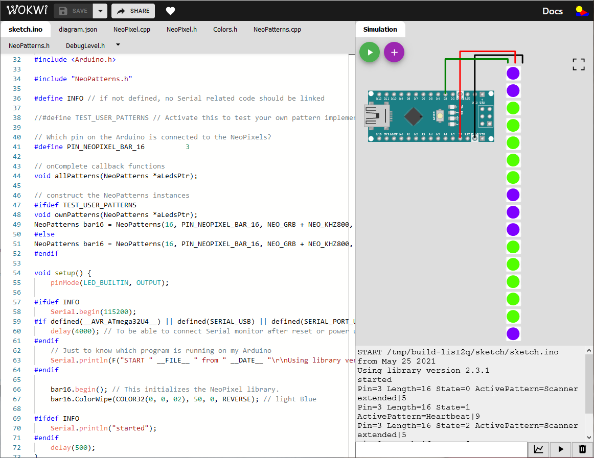
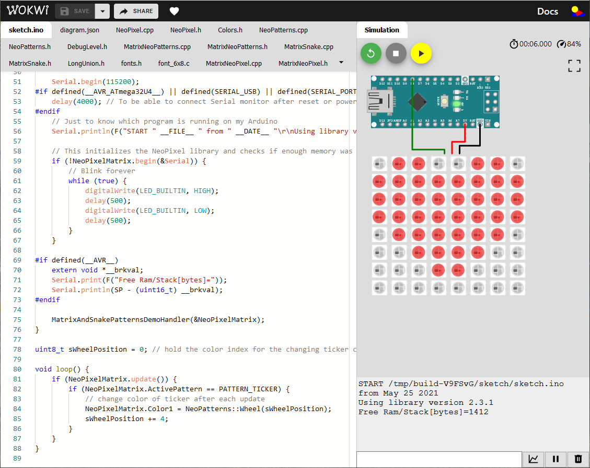
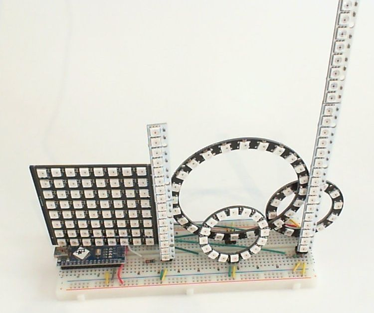
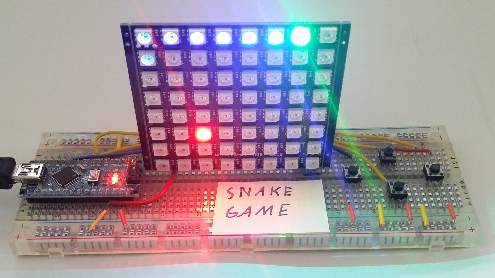

<div align = center>

# [NeoPatterns](https://github.com/ArminJo/NeoPatterns) for NeoPixel strips and Snake game for NeoPixel matrix.
This is an extended version of the [NeoPattern example by Adafruit](https://learn.adafruit.com/multi-tasking-the-arduino-part-3?view=all).<br/>
New patterns are added, a [snake game running on a matrix](https://github.com/ArminJo/NeoPatterns/blob/master/examples/SnakeGame/SnakeGame.ino) and [VU bars](https://github.com/ArminJo/NeoPatterns/blob/master/examples/ThreeVUBars/ThreeVUBars.ino) are included<br/>
and you can run [multiple patterns simultaneously on the same strip](https://github.com/ArminJo/NeoPatterns/blob/master/examples/TwoPatternsOnOneStrip/TwoPatternsOnOneStrip.ino).

[](https://www.gnu.org/licenses/gpl-3.0)
 &nbsp; &nbsp; 
[](https://github.com/ArminJo/NeoPatterns/releases/latest)
 &nbsp; &nbsp; 
[](https://github.com/ArminJo/NeoPatterns/commits/master)
 &nbsp; &nbsp; 
[](https://github.com/ArminJo/NeoPatterns/actions)
 &nbsp; &nbsp; 

<br/>
<br/>
[](https://stand-with-ukraine.pp.ua)

Available as [Arduino library "NeoPatterns"](https://www.arduinolibraries.info/libraries/neo-patterns).

[](https://www.ardu-badge.com/NeoPatterns)
 &nbsp; &nbsp; 
[](https://github.com/ArminJo/NeoPatterns?tab=readme-ov-file#revision-history)

</div>

#### If you find this library useful, please give it a star.

&#x1F30E; [Google Translate](https://translate.google.com/translate?sl=en&u=https://github.com/ArminJo/NeoPatterns)

<br/>

# Table of content
- [Features](https://github.com/ArminJo/NeoPatterns?tab=readme-ov-file#features)
- [Videos](https://github.com/ArminJo/NeoPatterns?tab=readme-ov-file#videos)
- [Installation](https://github.com/ArminJo/NeoPatterns?tab=readme-ov-file#installation)
- [Quick start](https://github.com/ArminJo/NeoPatterns?tab=readme-ov-file#quick-start)
- [Patterns](https://github.com/ArminJo/NeoPatterns?tab=readme-ov-file#patterns)
- [VU bars](https://github.com/ArminJo/NeoPatterns?tab=readme-ov-file#vu-bars)
- [NeoPixel library](https://github.com/ArminJo/NeoPatterns?tab=readme-ov-file#neopixel-library)
- [Matrix pixel mappings](https://github.com/ArminJo/NeoPatterns?tab=readme-ov-file#matrix-pixel-mappings)
- [Timing](https://github.com/ArminJo/NeoPatterns?tab=readme-ov-file#timing)
- [Using the *.hpp files / how to avoid `multiple definitions` linker errors](https://github.com/ArminJo/NeoPatterns?tab=readme-ov-file#using-the-new-hpp-files--how-to-avoid-multiple-definitions-linker-errors)
- [Compile options / macros for this library](https://github.com/ArminJo/NeoPatterns?tab=readme-ov-file#compile-options--macros-for-this-library)
- [Online simulations](https://github.com/ArminJo/NeoPatterns?tab=readme-ov-file#online-simulations)
- [Examples for this library](https://github.com/ArminJo/NeoPatterns?tab=readme-ov-file#examples-for-this-library)
- [Revision History](https://github.com/ArminJo/NeoPatterns?tab=readme-ov-file#revision-history)
- [CI](https://github.com/ArminJo/NeoPatterns?tab=readme-ov-file#ci)

<br/>

# Features
- **Non blocking patterns** for strips, rings and matrixes. Just call `update()` in your loop.
- **Multiple patterns** can run simultaneously on one physical strip.
- A **callback function** is called at the end of each pattern to start the next one.
- **Your own patterns** can easily be added.
- **Snake game** for matrixes, which can be played by buttons or serial input, or runs by itself.
- **VU bars** for strips and matrixes with dampening, automatic scaling and falling peak pixel.
- Support for **RGB and RGBW** pixels.
- Support for **brightness**, including a mode which does not blank out heavily dimmed pixels.
- **Only the patterns you need** are compiled, if you [select them individually](https://github.com/ArminJo/NeoPatterns?tab=readme-ov-file#neopatterns).

<br/>

# Videos

| NeoPatternsDemo | MatrixDemo on a 10x10 matrix |
| :-: | :-: |
| [](https://www.youtube.com/watch?v=CsB7FkywCRQ) | [](https://www.youtube.com/watch?v=URsq28l2PEQ) |
| **NeoPatternsDemo on a long matrix** | **Fire on a long matrix** |
| [](https://www.youtube.com/watch?v=y_fmAEUqhFg) | [](https://youtu.be/CgW5T-mRSvQ?t=43) |
| **OpenLedRace at the Cologne public library MINTk&ouml;ln-Festival** |  |
| [](https://www.youtube.com/watch?v=y25rjRkDg0g) |  |

<br/>

# Installation
1. Install the **"Adafruit NeoPixel"** library with *Tools -> Manage Libraries...* or *Ctrl+Shift+I*. Use "neoPixel" as filter string.
2. Install this **"NeoPatterns"** library the same way. Use "NeoPatterns" as filter string.

<br/>

# Quick start
Start a pattern in `setup()`, call `update()` in `loop()` and start the next pattern in the callback function.

```c++
#include <Arduino.h>
#include <NeoPatterns.hpp>

#define PIN_NEOPIXEL 3

void patternCompleted(NeoPatterns *aLedsPtr); // is called each time a pattern has ended

NeoPatterns bar16 = NeoPatterns(16, PIN_NEOPIXEL, NEO_GRB + NEO_KHZ800, &patternCompleted);

void setup() {
    bar16.begin();
    bar16.ColorWipe(COLOR32_RED_HALF, 50); // start first pattern with 50 ms between 2 steps
}

void loop() {
    bar16.update(); // call this as often as possible
}

void patternCompleted(NeoPatterns *aLedsPtr) {
    aLedsPtr->RainbowCycle(20); // start next pattern
}
```

For a matrix, include `MatrixNeoPatterns.hpp` and use the class `MatrixNeoPatterns`, for the snake game, include `MatrixSnake.hpp` and use the class `MatrixSnake`.

<br/>

# PATTERNS
All patterns are started by calling a function of the same name.<br/>
Most of them take the interval in milliseconds between two steps as parameter. The functions `RainbowCycleDuration()`, `ColorWipeDuration()`, `FadeDuration()`, `StripesDuration()` and `ScannerExtendedDuration()` take the duration of the complete pattern instead.

## Patterns from [Adafruit](https://www.adafruit.com/)

| Pattern | Function | Description |
|-|-|-|
| RAINBOW_CYCLE | `RainbowCycle()` | Moving rainbow. |
| COLOR_WIPE | `ColorWipe()` | Fills the strip pixel by pixel with one color. |
| FADE | `Fade()` | Fades all pixels from one color to another. |

## New patterns

| Pattern | Function | Description |
|-|-|-|
| DELAY | `Delay()` | Keeps the current content for the specified time. |
| SCANNER_EXTENDED | `ScannerExtended()` | Moving pixels with a dimmed tail. Includes **CYLON** as well as **ROCKET** or **FALLING_STAR** and supports bouncing. |
| STRIPES | `Stripes()` | Moving stripes of two colors. Replaces the old **THEATER_CHASE** pattern. |
| FLASH | `Flash()` | Alternates between two colors with individual intervals. |
| TWINKLE | `Twinkle()` | Randomly appearing and disappearing pixels of one or random colors. |
| PROCESS_SELECTIVE | `ProcessSelectiveColor()` | Calls a function like `FadeColor()`, `DimColor()` or `BrightenColor()` for all pixels with the specified color. |
| HEARTBEAT | `Heartbeat()` | Brightens and dims one color. |
| BOUNCING_BALL | `BouncingBall()` | A falling and bouncing pixel. |

## Pattern from FastLED

| Pattern | Function | Description |
|-|-|-|
| FIRE | `Fire()` | Adapted from [FastLED Fire2012](https://github.com/FastLED/FastLED/tree/master/examples/Fire2012). |

## Patterns only for n x n matrix

| Pattern | Function | Description |
|-|-|-|
| MOVING_PICTURE | `MovingPicturePGM()` | Moves an 8x8 graphic in or out. |
| MOVE | `Move()` | Moves the current content out. |
| TICKER | `Ticker()` `TickerPGM()` | Scrolling text. Supports `DIRECTION_LEFT`, `DIRECTION_UP` and `DIRECTION_NONE`. |
| FIRE | `Fire()` | Two-dimensional fire. |
| SNOW | `Snow()` | Falling snowflakes. |
| SNAKE | `Snake()` | The snake game. Requires `MatrixSnake.hpp`. |

## You can provide your own patterns

| Pattern | Function |
|-|-|
| USER_PATTERN1 | `UserPattern1()` |
| USER_PATTERN2 | `UserPattern2()` |

User patterns must be enabled by `#define ENABLE_PATTERN_USER_PATTERN1` and `#define ENABLE_PATTERN_USER_PATTERN2`.<br/>
**See [UserPattern example](https://github.com/ArminJo/NeoPatterns/blob/master/examples/UserPattern/UserPattern.ino).**

<br/>

# VU bars
`NeoPixelVU` shows a value as a bar on a strip, `MatrixNeoPixelVU` shows one bar for each column of a matrix.
- **Dampening** of the input value.
- **Automatic scaling** (default) or **fixed scaling**.
- **Linear** (default) or **logarithmic** display.
- **Peak pixel**, which falls down slowly.
- Bar in **one color** or with the colors of a **32 or 16 bit color array**. A 16 bit array requires only half of the RAM.

Multiple `NeoPixelVU` bars of the same length can share one `NeoPixel` object, even if they are connected to different pins. This saves a lot of RAM.

```c++
#include <Arduino.h>
#include <NeoPixelVU.hpp>

#define PIN_VU_BAR 3

NeoPixel LEDBar = NeoPixel(16, PIN_VU_BAR, NEO_GRB + NEO_KHZ800);
color32_t BarColorArray[16];
// Damping factor 2, automatic scaling
NeoPixelVU VUMeter(PIN_VU_BAR, &LEDBar, 2, FLAG_VU_SCALED_LINEAR_AUTOMATIC, BarColorArray);

void setup() {
    LEDBar.begin();
    VUMeter.initBarColorRYG(); // green, yellow and red bar
}

void loop() {
    VUMeter.setBarAndPeakAndShow(analogRead(A0));
    delay(20);
}
```

### Flags

| Flag | Description |
|-|-|
| `FLAG_VU_SCALED_LINEAR_AUTOMATIC` | Default. Linear display, the scaling is adapted automatically to the maximum input value. |
| `FLAG_VU_USE_FIXED_SCALING` | Scaling with a fixed value for the full bar. Is set automatically, if you specify a value for the full bar for a linear display. |
| `FLAG_VU_USE_VALUE_LOG` | Logarithmic display. If you specify a value for the full bar, the display is scaled accordingly. |
| `FLAG_VU_USE_HIGH_RES_DAMPENING` | Dampening with higher resolution for small values. Restricts the input to 0 to 127. |
| `FLAG_VU_USE_NO_PEAK` | Do not show a peak pixel. |

### Bar colors
These functions fill the color array specified at the constructor or `init()`. The functions ending with **16** are for 16 bit color arrays.

| 32 bit | 16 bit | Description |
|-|-|-|
| `initBarColorRYG()` | `initBarColorRYG16()` | Lower half is green, the next quarter yellow and the upper quarter red. |
| `initBarGreenToRed()` | `initBarGreenToRed16()` | Smooth transition from green to red. |
| `initBarColorWheel()` | `initBarColorWheel16()` | All colors of the color wheel. |

<br/>

# NeoPixel library
The included **NeoPixel library is an extension of the Adafruit NeoPixel library** and supports **multiple virtual NeoPixel (and NeoPattern) objects on one physical strip**. It also contains a lot of useful functions.

### Set and draw pixels

| Function | Description |
|-|-|
| `setColor(aColor)` | Sets all pixels to a color. |
| `setPixelColor16(aPixelIndex, aColor)` | Sets a pixel to a 16 bit (RGB 565) color. |
| `addPixelColor(aPixelIndex, aColor)` | Adds color to existing one and clips to white. |
| `clearPixel(aPixelIndex)`, `clearAndShow()` | Clears one or all pixels. |
| `fillRegion(aColor, aRegionStartIndex, aRegionLength)` | Sets a region of the strip to a color. |
| `copyRegion(aSourcePixelIndex, aTargetPixelIndex, aLength, aDoReverseCopy)` | Copies multiple pixels to another part of the strip. Optionally does a reverse copy. |
| `fillWithRainbow(aRainbowWheelStartPos, aStartAtTop)` | Fills the strip with a rainbow. |
| `drawBar(aBarLength, aColor, aDrawFromTop)` | Draws a bar of pixels starting at the lower or upper end. |
| `drawBarFromColorArray(aBarLength, aColorArrayPtr, aDrawFromTop)` | Uses a 32 or 16 bit color array for the different colors of the bar pixels. Useful e.g. for VU meters. |

### Brightness and colors

| Function | Description |
|-|-|
| `setBrightness(aBrightness)` | Sets the brightness used by the drawing functions. Must be called before drawing. |
| `setBrightnessNonZeroMode(aEnable)` | If enabled, a pixel is only set to zero if brightness or color is zero. |
| `Wheel(aWheelPos)` | Returns colors from a color wheel starting at red. |
| `dimColor(aColor)` | Returns the 50% dimmed version of a color without using gamma. |
| `gamma5(aLinearBrightnessValue)` | Returns the gamma corrected value of a linear brightness value. |
| `convertLinearToGamma5Color(aLinearBrightnessColor)` | Returns the gamma corrected color. |
| `dimColorWithGamma5(aLinearBrightnessColor, aBrightness)` | Returns the color dimmed by the gamma corrected brightness. |
| `getRedPart(aColor)`, `getGreenPart(aColor)`, `getBluePart(aColor)`, `getWhitePart(aColor)` | Returns one component of a 32 bit color. |
| `Color32ToColor16(aColor)`, `Color16ToColor32(aColor)` | Converts between 32 bit and 16 bit (RGB 565) colors. |

### Info and special functions

| Function | Description |
|-|-|
| `printConnectionInfo(&Serial)` | Prints length, pin and offset. |
| `getBytesPerPixel()` | Returns 3 for RGB and 4 for RGBW pixels. |
| `getAndAdjustActualNeopixelLengthSimple()` | Uses ADC and the VCC voltage drop to determine the actual length of a strip. Requires `#include "ADCUtils.hpp"` before `#include <NeoPatterns.hpp>`. Based on the idea of [Tim](https://cpldcpu.com/2014/11/16/ws2812_length/). |

<br/>

# Matrix pixel mappings
**Origin (0,0) of x and y values is at the top left corner and the positive direction is right and DOWN.**

Pixel mapping definitions and semantics are taken from [Adafruit_NeoMatrix.h](https://github.com/adafruit/Adafruit_NeoMatrix/blob/master/Adafruit_NeoMatrix.h).
There you also find mappings for tiled displays with multiple matrixes.

Examples for LED index to position mappings:
```
     ProgressiveMapping                  ZigzagTypeMapping
   Regular        Mirrored           Regular        Mirrored
   Bottom/Right   Bottom/Left
   15 14 13 12    12 13 14 15        12 13 14 15    15 14 13 12
   11 10  9  8     8  9 10 11        11 10  9  8     8  9 10 11
    7  6  5  4     4  5  6  7         4  5  6  7     7  6  5  4
    3  2  1  0     0  1  2  3         3  2  1  0     0  1  2  3
```

**All matrix pixel mappings except `NEO_MATRIX_COLUMNS` are supported.**
In case you need the `NEO_MATRIX_COLUMNS` layout, try to rotate your matrix and use `NEO_MATRIX_ROWS`, or use your own custom mapping function with `setLayoutMappingFunction()`.

<br/>

# Timing
WS2812 LEDs require an 800 kHz bit signal and 24 bit per LED, resulting in 30 &micro;s (33 kHz) per LED.

| Number of LEDs | Time for one `show()` | Maximum refresh rate (without reset time) |
|-:|-:|-:|
| 8 (bar) | 0.24 ms | 4170 Hz |
| 64 (8x8 matrix) | 1.92 ms | 520 Hz |
| 550 | 16.5 ms | 60 Hz |

<br/>

# Using the new *.hpp files / how to avoid `multiple definitions` linker errors
In order to support [compile options](https://github.com/ArminJo/NeoPatterns?tab=readme-ov-file#compile-options--macros-for-this-library) more easily, the source code is contained in `*.hpp` files.

| Where | What to include |
|-|-|
| Your **main program**, i.e. the *.ino file with `setup()` and `loop()` | The `*.hpp` file(s), e.g. `#include <NeoPatterns.hpp>`, like it is done in the examples. |
| **All other files** | The corresponding `*.h` files, e.g. `#include <NeoPatterns.h>`. Otherwise you will get tons of **"multiple definition"** errors. |

Each `*.hpp` file includes the other ones it requires:

| Include | If you want to use |
|-|-|
| `NeoPixel.hpp` | Only the NeoPixel functions |
| `NeoPatterns.hpp` | Patterns for strips and rings |
| `MatrixNeoPixel.hpp` | Only the NeoPixel functions for a matrix |
| `MatrixNeoPatterns.hpp` | Patterns for a matrix |
| `MatrixSnake.hpp` | Snake game and patterns for a matrix |
| `NeoPixelVU.hpp` | VU bars on strips |
| `MatrixNeoPixelVU.hpp` | VU bars on a matrix and on strips |

All macros which you define in your main program before `#include <NeoPatterns.hpp>` etc., e.g. `DO_NOT_USE_MATH_PATTERNS`, must also be defined before each include of `NeoPatterns.h` etc. in your other files, otherwise the include may not work as expected!

<br/>

# Compile options / macros for this library
To customize the library to different requirements, there are some compile options / macros available.<br/>
The macros must be defined in your program **before** the line which includes the `*.hpp` file to take effect.<br/>
Modify them by enabling / disabling them, or change the values if applicable.

## NeoPixel
For `NeoPixel.hpp`, `MatrixNeoPixel.hpp` and all other `*.hpp` files of this library.

| Name | Default value | Description |
|-|-:|-|
| `DO_NOT_SUPPORT_RGBW` | disabled | Disables RGBW pixels support. Activate it, if you only have RGB pixels. Saves up to 450 bytes program memory for the AllPatternsOnMultiDevices example. |
| `DO_NOT_SUPPORT_BRIGHTNESS` | disabled | Disables the brightness functions. Saves up to 376 bytes program memory for the AllPatternsOnMultiDevices example. |
| `DO_NOT_SUPPORT_NO_ZERO_BRIGHTNESS` | disabled | Disables the special brightness mode, which sets a dimmed pixel to 0 only if brightness or input color is zero, otherwise it is clipped at e.g. 0x000100. Saves up to 144 bytes program memory for the AllPatternsOnMultiDevices example. |
| `DELTA_MILLIVOLT_FOR_PIXEL_DETECTION` | 40 | Voltage drop in millivolt used by `getAndAdjustActualNeopixelLengthSimple()` to detect a pixel. |
| `TEST_PATTERN_LENGTH_FOR_PIXEL_DETECTION` | 1 | Number of pixels required by `getAndAdjustActualNeopixelLengthSimple()` for a successful detection. |

If you do not require the legacy 400 kHz functionality, you can disable the line `#define NEO_KHZ400 0x0100 ///< 400 KHz data transmission` in **Adafruit_NeoPixel.h**. This saves up to 260 bytes program memory and 1 byte RAM per NeoPixel object for the AllPatternsOnMultiDevices example.

## NeoPatterns
For `NeoPatterns.hpp`, `MatrixNeoPatterns.hpp` and `MatrixSnake.hpp`.

| Name | Default value | Description |
|-|-|-|
| `ENABLE_PATTERN_<Pattern name>` | all | Selection of individual pattern(s) to be enabled for your program. You can specify multiple patterns. As soon as you specify one, all patterns not specified are disabled. User patterns must always be enabled explicitly. See [NeoPatterns.h](https://github.com/ArminJo/NeoPatterns/blob/master/src/NeoPatterns.h). |
| `ENABLE_MATRIX_PATTERN_<Pattern name>` | all | The same for matrix pattern(s). If you specify one, the non matrix patterns are no longer enabled by default. See [MatrixNeoPatterns.h](https://github.com/ArminJo/NeoPatterns/blob/master/src/MatrixNeoPatterns.h). |
| `ENABLE_NO_NEO_PATTERN_BY_DEFAULT` | disabled | Disables the default selection of all non matrix patterns if no `ENABLE_PATTERN_<Pattern name>` is specified. Enables the exclusive use of matrix patterns. |
| `ENABLE_NO_MATRIX_AND_NEO_PATTERN_BY_DEFAULT` | disabled | Disables the default selection of all matrix and non matrix patterns if no `ENABLE_PATTERN_<Pattern name>` or `ENABLE_MATRIX_PATTERN_<Pattern name>` is specified. Enables the exclusive use of the snake pattern, which saves program memory. |
| `DO_NOT_USE_MATH_PATTERNS` | disabled | Disables the `BOUNCING_BALL` pattern, if it is not enabled explicitly. Saves from 0 up to 1140 bytes program memory, depending if floating point and sqrt() are already used otherwise. |
| `DO_NOT_SUPPORT_DYNAMIC_OBJECTS` | disabled | Saves up to 42 bytes program memory for the AllPatternsOnMultiDevices example, if you only use global matrix and snake objects. |
| `SUPPORT_ONLY_DEFAULT_GEOMETRY` | disabled | Disables other than the default matrix geometry, i.e. pixel 0 is at bottom right of matrix, matrix is row major (horizontal) and has the same pixel order across each line (no zig-zag). Saves up to 560 bytes program memory and 3 bytes RAM. |
| `FONT_END7F` | disabled | Disables the characters above 0x7F for the ticker. Saves up to 1024 bytes program memory for the 6x8 font. |
| `SNOW_SUPPORT_MORE_THAN_16_ROWS_AND_COLUMNS` | disabled | Required for the `SNOW` pattern on a matrix with more than 16 rows or columns. Requires 2 additional bytes RAM per flake. |

`<Pattern name>` is one of
- **Non matrix:** `RAINBOW_CYCLE`, `COLOR_WIPE`, `FADE`, `SCANNER_EXTENDED`, `STRIPES`, `FLASH`, `TWINKLE`, `PROCESS_SELECTIVE`, `HEARTBEAT`, `FIRE`, `BOUNCING_BALL`, `USER_PATTERN1`, `USER_PATTERN2`. `DELAY` is always enabled.
- **Matrix:** `TICKER`, `MOVE`, `MOVING_PICTURE`, `FIRE`, `SNOW`.

## Snake
For `MatrixSnake.hpp`.

| Name | Default value | Description |
|-|-|-|
| `ENABLE_PATTERNS_FOR_SNAKE_AUTORUN` | disabled | Selects the patterns used for the autorun mode of the snake game. |
| `ENABLE_PATTERNS_FOR_MATRIX_AND_SNAKE_DEMO_HANDLER` | disabled | Selects the patterns used by `MatrixAndSnakePatternsDemoHandler()`. |
| `ENABLE_USER_SNAKE_SOLVER` | disabled | Disables the built in solver function `getNextSnakeDirection()` and enables the [user provided solver function](https://github.com/ArminJo/NeoPatterns/blob/master/examples/SnakeSolver/SnakeSolver.ino). |
| `SNAKE_ALLOW_SERIAL_CONTROL` | disabled | Enables control of the snake by the characters w, a, s, d received by Serial. |

## VU bars
For `NeoPixelVU.hpp` and `MatrixNeoPixelVU.hpp`.

| Name | Default value | Description |
|-|-|-|
| `PEAK_PIXEL_COLOR` | `COLOR32_RED` | Color of the peak pixel. For `COLOR32_PEAK_RYG` the color is green, yellow or red depending on its position. |
| `CALLS_PER_PEAK_DROP` | 6 | Number of calls until the peak pixel falls by one. Can be changed at runtime with `setCallsPerPeakDrop()`. |
| `FACTOR_FOR_LOG` | `M_LOG2E` | Base of the logarithmic display. Default is log2. If you change it, you must also define `SCALE_VALUE_FOR_LOG_BAR(barLength)`. See [VUBar.h](https://github.com/ArminJo/NeoPatterns/blob/master/src/VUBar.h). |

<br/>

# Online simulations

| [AllPatternOnOneBar example](https://wokwi.com/arduino/projects/299556508969992714) | [MatrixDemo example](https://wokwi.com/arduino/projects/299560666027524617) |
| :-: | :-: |
| [](https://wokwi.com/arduino/projects/299556508969992714) | [](https://wokwi.com/arduino/projects/299560666027524617) |

There is also a [WOKWI online simulation of the SnakeGame example](https://wokwi.com/arduino/projects/422510026296881153).

<br/>

# Examples for this library
The examples are available at *File > Examples > Examples from Custom Libraries / NeoPatterns*.

| Strips and rings | Matrix | Snake | VU bars |
|-|-|-|-|
| [NeoPatternsSimpleDemo](https://github.com/ArminJo/NeoPatterns?tab=readme-ov-file#neopatternssimpledemo) | [MatrixDemo](https://github.com/ArminJo/NeoPatterns?tab=readme-ov-file#matrixdemo) | [SnakeGame](https://github.com/ArminJo/NeoPatterns?tab=readme-ov-file#snakegame) | [ThreeVUBars](https://github.com/ArminJo/NeoPatterns?tab=readme-ov-file#threevubars) |
| [AllPatternOnOneBar](https://github.com/ArminJo/NeoPatterns?tab=readme-ov-file#allpatternononebar) | [MatrixPatternsTest](https://github.com/ArminJo/NeoPatterns?tab=readme-ov-file#matrixpatternstest) | [SnakeSolver](https://github.com/ArminJo/NeoPatterns?tab=readme-ov-file#snakesolver) | [SoundToNeoPixelVU](https://github.com/ArminJo/NeoPatterns?tab=readme-ov-file#soundtoneopixelvu) |
| [MultiplePatternsOnOneBar](https://github.com/ArminJo/NeoPatterns?tab=readme-ov-file#multiplepatternsononebar) | [MatrixShowAllColors](https://github.com/ArminJo/NeoPatterns?tab=readme-ov-file#matrixshowallcolors) |  |  |
| [TwoPatternsOnOneStrip](https://github.com/ArminJo/NeoPatterns?tab=readme-ov-file#twopatternsononestrip) | [MatrixSnow](https://github.com/ArminJo/NeoPatterns?tab=readme-ov-file#matrixsnow) |  |  |
| [UserPattern](https://github.com/ArminJo/NeoPatterns?tab=readme-ov-file#userpattern) | [SnowFlakes](https://github.com/ArminJo/NeoPatterns?tab=readme-ov-file#snowflakes) |  |  |
| [OpenLedRace](https://github.com/ArminJo/NeoPatterns?tab=readme-ov-file#openledrace) |  |  |  |

[AllPatternsOnMultiDevices](https://github.com/ArminJo/NeoPatterns?tab=readme-ov-file#allpatternsonmultidevices) shows patterns for strips, rings and matrixes as well as the snake.

## NeoPatternsSimpleDemo
**Start with this example.** It runs patterns on one 16 pixel bar, using a callback function to start the next pattern.

## AllPatternOnOneBar
Shows all NeoPatterns included in the NeoPatterns library randomly on one 16 pixel bar.

## AllPatternsOnMultiDevices
Shows all patterns for strips, rings and matrixes included in the NeoPatterns, MatrixNeoPatterns and MatrixSnake library.<br/>
Brightness can be set by a voltage at pin A0.<br/>
Uses the included `allPatternsRandomHandler()` to [show all available patterns](https://www.youtube.com/watch?v=CsB7FkywCRQ).

AllPatternsOnMultiDevices on breadboard


## MultiplePatternsOnOneBar
Runs three 8 pixel patterns simultaneously on one 24 pixel bar.

## TwoPatternsOnOneStrip
Renders a slow "background pattern" and a fast "foreground pattern" on the same strip.<br/>
It also shows how to dynamically **determine the length of the attached strip** and to resize a parent pixel buffer.<br/>
The delay between the patterns can be set by a potentiometer at pin A0. The patterns can be stopped and resumed by a button at pin 2.

## UserPattern
Contains sample implementations of `UserPattern1()` and `UserPattern2()`, which can be used as template for your own patterns.

## OpenLedRace
Extended version of the OpenLedRace "version Basic for PCB Rome Edition. 2 Player, without Boxes Track".<br/>
See also the [dedicated repository for OpenLedRace](https://github.com/ArminJo/OpenledRace).

OpenLedRace at the Cologne public library MINTk&ouml;ln-Festival


## MatrixDemo
Runs the `MatrixAndSnakePatternsDemoHandler()` on one 8x8 matrix. It shows a ticker text, a moving heart with heartbeats, snake and fire.

## MatrixPatternsTest
For testing the matrix patterns fire, snow, all colors and snake.<br/>
Brightness can be set by a voltage at pin A0, fire cooling by a voltage at pin A1.<br/>
Patterns can be switched by a button at pin 2, or are switched automatically, if pin 10 is connected to ground.

## MatrixShowAllColors
Uses the `drawAllColors()` functions to show all colors. The colors are dimmed by using `storePixelBuffer()`, `restorePixelBuffer()` and `setBrightness()`.

## MatrixSnow
Snow pattern on an 8x8 or 16x16 matrix.

## SnowFlakes
Shows a fixed snowflake pattern on an 8x8 matrix and then creates random patterns.<br/>
Inspired by the [NeoPixel Matrix Snowflake Sweater](https://learn.adafruit.com/neopixel-matrix-snowflake-sweater).

## SnakeGame
The game can be controlled by 2 or 4 buttons or by serial input (WASD) from the keyboard.<br/>
After 7 seconds of inactivity after boot, the snake demo with a simple AI is started.

For **buttons**, the game starts in 2 button mode with one button for turn left and one for turn right. If the up or down button is pressed, 4 button mode is entered automatically.

For **keyboard control**, activate the line `#define SNAKE_ALLOW_SERIAL_CONTROL` in the example and start the Python script in the [extras folder](https://github.com/ArminJo/NeoPatterns/tree/master/extras) of the library with *RunPythonKeybordForInput.cmd*.<br/>
This script **sends a WASD key press immediately** and does not wait for a return or a press of the send button, as the Arduino Serial Monitor does.<br/>
The experimental script *Joystick2Serial.py* converts game controller input to appropriate serial output for the game.

SnakeGame with 4 buttons on breadboard


## SnakeSolver
**With this example you can prove your skill to write an AI to solve the snake game.** Just put your code into the `getNextSnakeDirection()` function.

## ThreeVUBars
Shows three VU bars with different colors and scalings, which share one `NeoPixel` object.<br/>
The value is generated, or read from pin A2, if pin 12 is connected to ground.

## SoundToNeoPixelVU
Shows the sound signal at pin A0 on four 16 pixel VU bars and its 8 channel FFT spectrum on an 8x8 matrix.<br/>
If pin 9 is connected to ground and released, a noise measurement is taken. If pin 11 is connected to ground, the values are printed for the Arduino Plotter.<br/>
Written for the ATmega328 (Uno, Nano), since it directly uses the ADC registers and an FFT in AVR assembler.

<br/>

# Revision History
### Version 4.0.0
- New classes `VUBar`, `NeoPixelVU` and `MatrixNeoPixelVU` for VU bars and new examples ThreeVUBars and SoundToNeoPixelVU.
- New functions `setPixelColor16()`, `Color32ToColor16()` and `Color16ToColor32()`.
- `drawBarFromColorArray()` now also supports 16 bit color arrays.
- Fixed bugs.

**Changes which may require changes in your program:**
- Parameter `aDrawFromBottom` of `drawBar()` and `drawBarFromColorArray()` is replaced by `aDrawFromTop`, which has the **inverted meaning**. The default is still to draw from bottom.
- `NeoPixel::drawBarFromColorArray()` now uses the first color of the array for the pixel where the bar starts. Before, the order of the colors was reversed.
- Renamed `getAndAdjustActualNeopixelLenghtSimple()` to `getAndAdjustActualNeopixelLengthSimple()` and `AdafruitNeoPixelIinit()` to `AdafruitNeoPixelInit()`.
- Snake length and high score are now 8 bit, `TotalStepCounter` is now unsigned and parameter `aCompleteDurationMillis` of `RainbowCycleDuration()` is now 16 bit.
- Type of parameter `aTypeOfPixel` of the matrix constructors and `init()` functions is now `neoPixelType`.
- `MatrixSnake::updateOrRedraw()` is deprecated, use `update()` instead. Removed parameter `aDoUpdate` of `SnakeUpdate()`.
- The included `Adafruit_NeoPixel.h` file has `#define NEO_KHZ400` disabled, which saves up to 260 bytes for AllPatternsOnMultiDevices.
- Removed all functions and definitions, which were already deprecated in version 3.5.

### Version 3.5.0
- Minor improvements.
- Added `printPatternName(Print *aSerial)`.
- Changed function signatures; Parameter `Print *aSerial` is always the first parameter.
- Improved examples.

### Version 3.4.0
- Renamed `UnderlyingNeoPixelObject` to `ParentNeoPixelObject`.
- Fixed bug in `TWINKLE`, which did not clear the last pixel.

### Version 3.3.1
- Fixed bug in `allPatternsRandomHandler()`.

### Version 3.3.0
- New pattern `TWINKLE`.
- New functions `setCompensatedInterval()` and `copyRegion()`.
- Renamed `ColorWipeD()` to `ColorWipeDuration()` etc. and new `FadeDuration()` etc.
- Renamed `setBrightnessValue()` to `setBrightness()`.
- Copied and used `random8()` from [FastLED](https://github.com/FastLED/FastLED/blob/master/src/lib8tion/random8.h).

### Version 3.2.0
- Added functions `getActualNeopixelLenghtSimple()`, `clearAndShow()`, `setMatrixPixelColorAndShow()` and `testMapping()`.
- Improved `SNOW` pattern.
- New handling for `USER_PATTERN1` and `USER_PATTERN2` and new UserPattern example.
- Improved MatrixPatternsTest example.

### Version 3.1.1
- Added parameter `aRepetitions` to pattern `RainbowCycle`.
- Improved layout of character c.

### Version 3.1.0
- Added functions `printConnectionInfo()`, `fillRegion()`, `stop()` and `stopAllPatterns()`.
- Fixed brightness initialization bug for Neopixel with UnderlyingNeoPixelObjects.
- Renamed `updateAll*` and `updateAndWait*` functions.
- Now all NeoPattern objects are contained in NeoPatterns list.
- Now `updateOrRedraw()` does never call `show()`.
- New pattern `FLASH`.
- Renamed `ColorSet()` to `setColor()`.

### Version 3.0.0
- Enabled individual selection of patterns to save program memory.
- Renamed *NeoPatterns.cpp*, *MatrixNeoPatterns.cpp* and *MatrixSnake.cpp* to *NeoPatterns.hpp*, *MatrixNeoPatterns.hpp* and *MatrixSnake.hpp*.
- Renamed matrix pattern macros from `PATTERN_*` to `MATRIX_PATTERN_*`.
- Changed parameter for endless repeats in `initMultipleFallingStars()`.
- Improved usage of `random()`.
- Added function `fillRegion()`, `isActive()` and `setAdafruitBrightnessValue()`.
- Added support for brightness and brightness non zero mode.
- Fixed aDoUpdate bug for `FADE`.
- Fixed bugs in *Colors.h*.

### Version 2.4.0
- Added macros `ENABLE_PATTERN_<pattern_name>` to enable reducing size, if some patterns are not used.
- Renamed `NeoPatterns.cpp` to `NeoPatterns.hpp` to enable easy configuration by main program.
- Fixed brightness bug in `decrementTotalStepCounter()`.
- Changed parameter for endless repeats in `NeoPatterns::initMultipleFallingStars()`.
- Improved usage of `random()`.
- Added function `NeoPixel::fillRegion()`, `NeoPatterns::isActive()` and `NeoPixel::setAdafruitBrightnessValue()`.

### Version 2.3.1
- Changed type of TotalStepCounter from uint16_t to int16_t.
- Added `SnowMatrix` pattern.
- Improved debugging.
- Fixed `random()` bug for ESP32.
- Improved Fire cooling.

### Version 2.3.0
- Changed `TickerUpdate()` and `loadPicture()` and their callers to achieve that YOffset is consistent with Y direction and origin.
- Removed restriction to 8 columns for `FireMatrix` pattern.

### Version 2.2.2 + 2.2.3 (2.2.2 was an incomplete version)
- Fixed bugs if rows are not equal columns.
- Fixed bug in MatrixNeoPatterns constructor.
- Added `SUPPORT_ONLY_DEFAULT_GEOMETRY` compile option.
- Added `loadPicture()` for 16 bit pictures.
- Ticker now supports multiple characters and `DIRECTION_NONE`.

### Version 2.2.1
- Removed blocking wait for ATmega32U4 Serial in examples.

### Version 2.2.0
- Added support for RGBW patterns. Requires additional 200 bytes for the AllPatternsOnMultiDevices example. Deactivate the line `#define SUPPORT_RGBW` or defining `DO_NOT_SUPPORT_RGBW` saves 400 bytes program memory for the AllPatternsOnMultiDevices example.
- Use type `Print *` instead of `Stream *`.
- Changed function `addPixelColor()`.
- Added function `NeoPixel::printInfo(aSerial)`.
- Added `*D` functions, which take the duration of the whole pattern as argument.
- Added OpenLedRace example.
- Added empty constructor and `init()` functions.
- Added function `updateAllPartialPatterns()`.

### Version 2.1.0
- Ported to ESP8266 and ESP32.
- Changed signature of `NeoPatterns(NeoPixel *aUnderlyingNeoPixelObject)`. Swapped 4. and 5. parameter to make it consistent to the NeoPixel signature.
- Function `setPixelOffsetForPartialNeoPixel()` in NeoPixel.cpp added.

### Version 2.0.0
- Rewrite of most patterns control logic.
- Function `drawBar()` in NeoPixel.cpp added.
- Swapped parameter aNumberOfSteps and aIntervalMillis of `Stripes()`.
- Pattern `HEARTBEAT` and `BOUNCING_BALL` added.
- Swapped first parameter and added parameter aDirection to `Fire()`.
- Changed internal functions.
- Reworked `UserPattern`.

### Version 1.1.0
- Function `getPatternName()` added.
- Function `printPatternName()` added.
- Improved support for pattern running on parts of NeoPixel bars etc.
- New example for 3 pattern running on parts of one NeoPixel bar.
- New simple example.
- Changed signature of `Stripes()` and reset `ActivePattern` to `PATTERN_NONE` at the end of each pattern.

### Version 1.0.1
- Support of pattern running on parts of NeoPixel bars etc.

### Version 1.0.0
- Initial Arduino library version

<br/>

# CI
The library examples are compiled with GitHub Actions for the following boards:

| Board | Examples not compiled for this board |
|-|-|
| Arduino Uno |  |
| Arduino Leonardo | AllPatternsOnMultiDevices, OpenLedRace |
| Arduino Mega 2560 | SoundToNeoPixelVU |
| ESP8266 | OpenLedRace, MatrixPatternsTest, TwoPatternsOnOneStrip, SoundToNeoPixelVU, ThreeVUBars |
| ESP32 | OpenLedRace, MatrixPatternsTest, TwoPatternsOnOneStrip, SoundToNeoPixelVU |
| STM32 (BluePill F103C8) | OpenLedRace, MatrixPatternsTest, TwoPatternsOnOneStrip, SoundToNeoPixelVU |

The ESP8266 port was tested with a LOLIN D1 R2 board, the ESP32 port with an ESP32 DEVKITV1 board.
